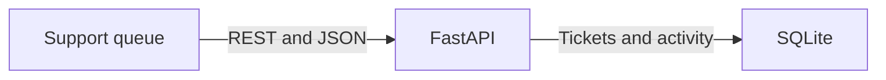

# RelayDesk

**A local-first IT help desk for tracking support requests from intake to resolution.**

Inspired by Tier 1 support work, RelayDesk lets an agent prioritize incoming requests, record troubleshooting steps, and resolve or reopen tickets. Each status change is recorded alongside the agent's notes in an activity timeline.

**Stack** · Python · FastAPI · SQLite · JavaScript · Playwright · Docker · GitHub Actions

## Engineering highlight

Two browser tabs can show the same version of a ticket. If both try to change its status, the first write increments the version. The second receives HTTP 409 and can reload the ticket. The status change and activity entry share one transaction, so either both are saved or neither is.



## Run on your Mac

Requires Python 3.12 or later. In VS Code, open the extracted `relaydesk` folder and run:

```bash
python3 -m venv .venv
source .venv/bin/activate
python -m pip install -r requirements.txt
python -m uvicorn app:app
```

Open [the support queue](http://127.0.0.1:8000) and [interactive API docs](http://127.0.0.1:8000/docs). The server inserts three fictional tickets into an empty database by default. Set `RELAYDESK_SEED=0` before startup to start with an empty queue. The database is stored in `relaydesk.db` by default. Set `RELAYDESK_DB` to a file path to use a different database. The parent directory must already exist.

## Five-minute demo

1. Create a high-priority Network ticket named “Conference room Wi-Fi disconnects.”
2. Select **Start work**, then add a note. For example, “Verified the IP address and default gateway. The issue only reproduces while roaming.”
3. Resolve the ticket. Show the activity timeline, then filter the queue to **Resolved** and search for the ticket.
4. Reload the page and show that the ticket and history are still there.
5. Open **API reference**. Explain why two agents reacting to the same ticket version cannot both update its status. Run the API tests to prove it.

## Architecture and tradeoffs

| Layer | Implementation |
| --- | --- |
| Browser | HTML, CSS and JavaScript served from the same origin as the API. The browser filters the small local demo queue and renders user input as text. |
| API | FastAPI and Pydantic handle REST operations and input validation. OpenAPI documentation is available at /docs. |
| Data | SQLite stores tickets and their activity in separate tables with a foreign key. Parameterized queries bind values safely. |
| Concurrency | A status change takes a write transaction, checks the submitted version, validates the transition, and writes the new status and activity together. A stale write receives HTTP 409. |
| Delivery | A Dockerfile runs the app as a non-root user. A GitHub Actions workflow runs the API and browser suites and builds the image. |

Ticket flow is **Open → In progress → Resolved → Open**. Activity is ordered by insertion ID so events created within the same second still have a stable order. SQLite keeps setup small and serializes writers. A shared production deployment would need authenticated users, authorization, actor IDs in the activity history, server-side pagination, and persistent storage. This demo has a shared queue intended for local use with fictional data.

## Verify locally

```bash
python -m pip install -r requirements-dev.txt
python -m unittest -v
python -m playwright install chromium
```

With the demo running in a second terminal, execute `python browser_check.py`. It exercises ticket creation, status changes, notes, search, and persistence across a reload. Each run creates a uniquely named ticket.

Build and run a container locally if you have Docker:

```bash
docker build -t relaydesk .
docker run --rm -p 127.0.0.1:8000:8000 -v relaydesk-data:/data relaydesk
```

## CI

GitHub Actions runs the API tests, exercises the ticket workflow in Chromium, and builds the Docker image. Open an Actions run and download the **relaydesk-preview** artifact to see the dashboard and ticket activity screenshots captured by the browser check.
